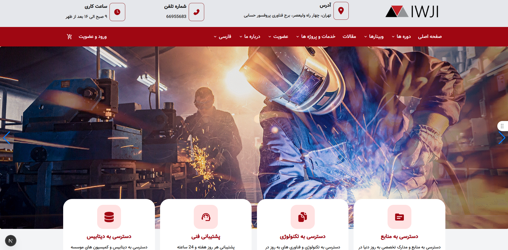
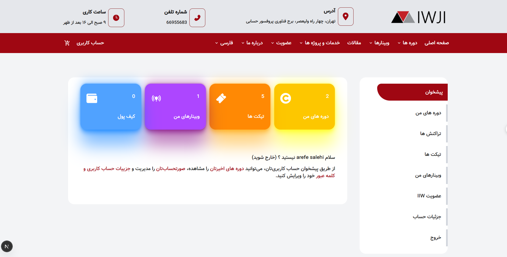
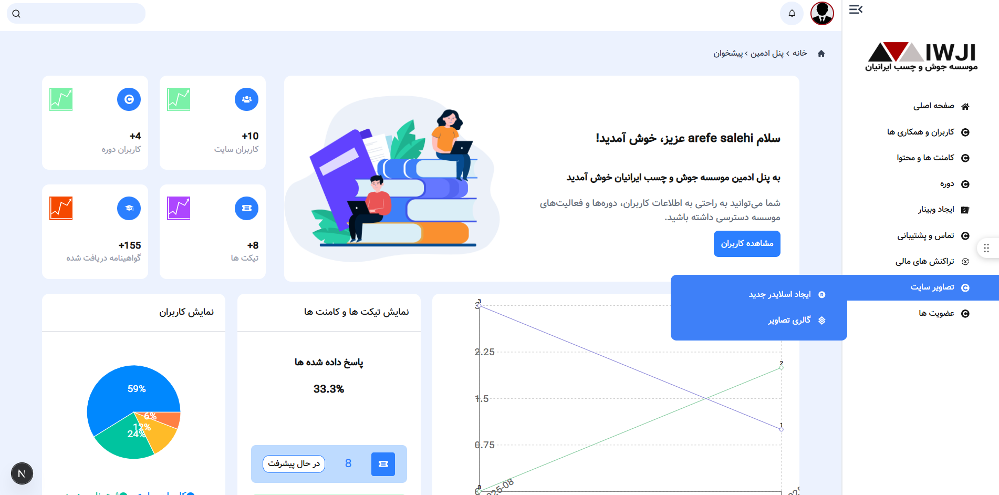
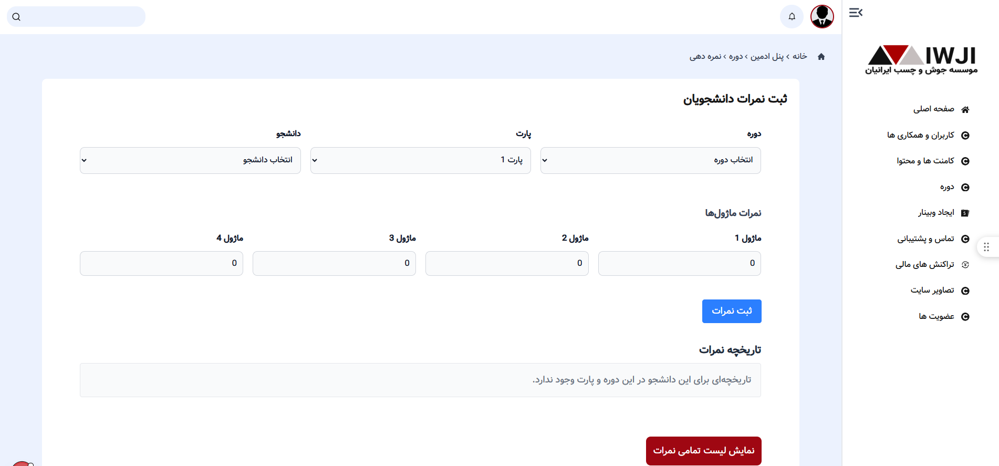

# 🎓 Online Learning Management System

A full-stack, bilingual Learning Management System (LMS) built with **Next.js** and **MongoDB**, featuring dedicated student and admin dashboards, authentication, course management, academic planning, grading, webinars, and educational content publishing.

The platform provides an integrated environment for managing online courses, student accounts, learning resources, and administrative operations.

---

## 📸 Screenshots

### Home Page



### Student Dashboard



### Admin Dashboard


### Course Schedule & Grades



---

## ✨ Features

### 🌍 Bilingual Interface
- Support for two languages
- Multilingual user experience

### 🔐 Authentication & User Management
- User registration and login
- Authentication and access to role-specific dashboards
- Individual student accounts
- Student account details and profile management

### 🎓 Student Dashboard
- Access to enrolled courses
- View personalized course schedules
- Access recorded class links
- View grades and academic progress
- Submit and track support tickets
- Manage account information

### 🛠️ Admin Dashboard
- Manage student accounts and course information
- Create and assign personalized study schedules
- Manage recorded class links
- Manage individual student login credentials
- Record and manage student grades
- Create and manage webinars
- Publish and manage educational articles
- Manage student support requests

### 📚 Course & Learning Management
- Course listing and registration
- Student-specific learning resources
- Academic schedule management
- Recorded class access
- Grade management

### 🎫 Support System
- Student ticket submission
- Ticket tracking and management

---

## 🛠️ Tech Stack

| Technology | Purpose |
|---|---|
| Next.js | Full-stack application framework |
| React | Component-based user interface |
| MongoDB | Database |
| JavaScript / TypeScript | Application logic |
| HTML & CSS | Structure and styling |

*Additional libraries and tools can be listed here based on the project's actual dependencies.*

---

## 🏗️ Architecture

The application combines frontend and backend functionality in a single Next.js project, with MongoDB used for data persistence.

The main functional areas include:

- Authentication and access control
- Student account management
- Course and schedule management
- Grade management
- Webinar and article management
- Support ticket management

---

## 🚀 Getting Started

### Prerequisites

- Node.js
- npm
- MongoDB instance or MongoDB Atlas account

### Installation

**1. Clone the repository**

```bash
git clone YOUR_REPOSITORY_URL
```

**2. Navigate to the project directory**

```bash
cd YOUR_PROJECT_DIRECTORY
```

**3. Install dependencies**

```bash
npm install
```

**4. Configure environment variables**

Create a `.env.local` file in the project root and add the environment variables required by the application.

Example:

```env
MONGODB_URI=your_mongodb_connection_string
```

Add any additional variables required by your authentication configuration.

**5. Start the development server**

```bash
npm run dev
```

Open [http://localhost:3000](http://localhost:3000) in your browser.

*Note: Environment variable names and setup instructions should match the actual project configuration.*

---

## 🔒 Security

- Authentication for user access
- Role-based access control, where implemented
- Environment variables for sensitive configuration
- Protected administrative functionality

---

## 🎯 Project Goals

This project demonstrates practical experience in:

- Full-stack development with Next.js
- Database integration with MongoDB
- Authentication and user management
- Role-specific dashboards
- CRUD operations and data management
- Course and academic workflow management
- Building a bilingual web application
- Designing integrated administrative and student experiences

---

## 👩‍💻 Author

**Arefe Salehi**

Frontend & Full-Stack Developer

- GitHub: [@arefesalehi](https://github.com/arefesalehi)

---

⭐ If you find this project interesting, feel free to explore the repository.
